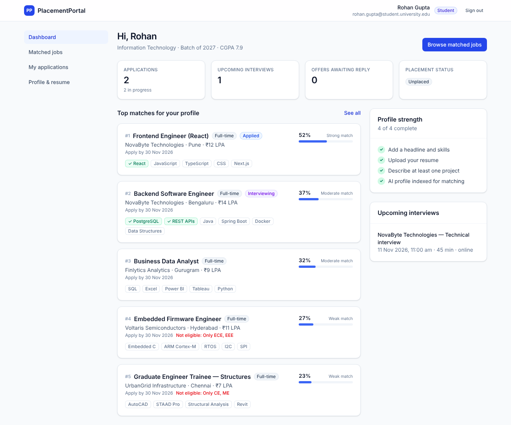
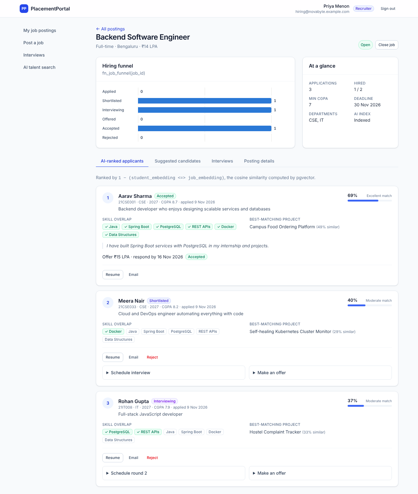
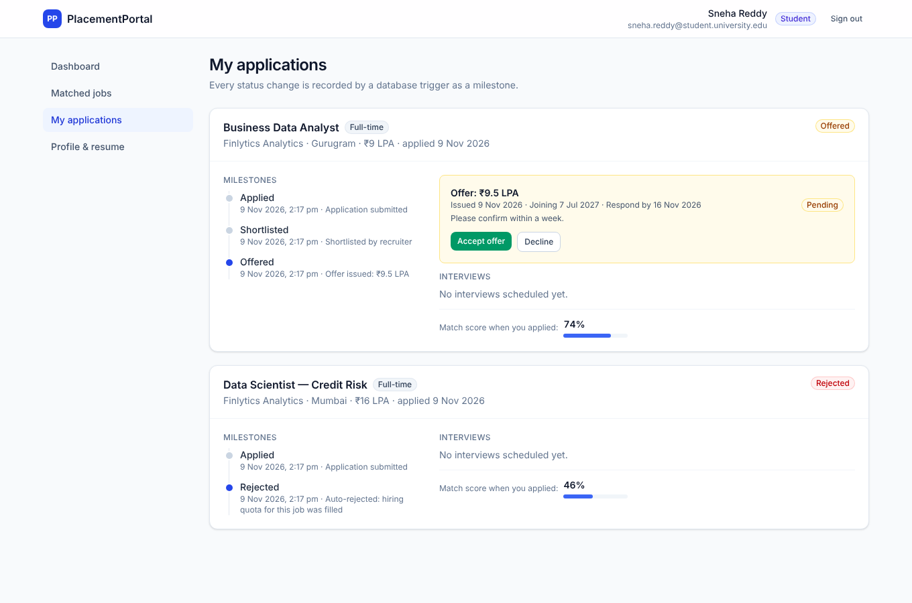
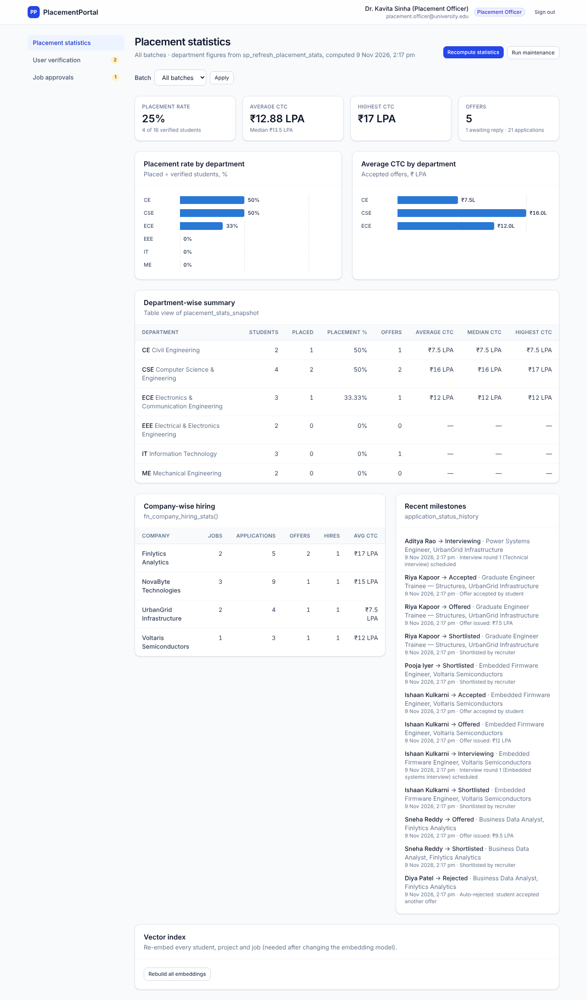
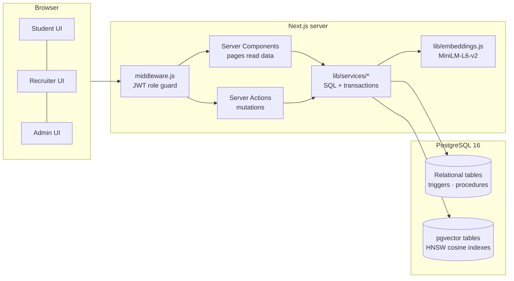

# PlacementPortal: AI-Matched Campus Placement Portal

A dual-database university placement portal built with **Next.js 14 (App Router)** and **PostgreSQL + pgvector**.

* The **relational side** keeps students, recruiters, job postings, applications, interviews and offers consistent. It uses foreign keys, CHECK constraints, ENUM types, triggers, stored procedures and ACID transactions.
* The **vector side** stores 384-dimension embeddings of resumes, projects and job descriptions (`all-MiniLM-L6-v2`). It ranks candidates and jobs by **cosine similarity**, so matching works on meaning instead of exact keywords.

---

## 1. Requirement → implementation map

| Requirement | Where it lives |
|---|---|
| Entities: Students, Recruiters, JobPostings, Applications, Interviews, Offers | `db/01_schema.sql` |
| Vector DB for resumes, project summaries and job requirements | `student_embeddings`, `project_embeddings`, `job_embeddings` tables (pgvector `vector(384)`, HNSW indexes) |
| Embedding model `all-MiniLM-L6-v2` (or OpenAI) | `lib/embeddings.js` (switch with `EMBEDDING_PROVIDER`) |
| Cosine similarity match scores | `lib/services/matching.js` uses `1 - (a <=> b)` |
| Roles: Student / Recruiter / Placement Officer | `middleware.js`, `lib/auth.js`, `app/student`, `app/recruiter`, `app/admin` |
| **Transaction**: accepting an offer atomically rejects other applications and locks the student | `lib/services/offers.js → acceptOffer()` |
| **Stored procedures**: department-wise placement % and average CTC | `db/03_procedures.sql → sp_refresh_placement_stats`, `fn_department_placement_stats`, … |
| **Trigger**: close a job when the application limit or hiring quota is reached | `db/02_triggers.sql → fn_auto_close_job` |
| **Vector similarity search** for AI matchmaking | `lib/services/matching.js` (4 different vector queries) |
| Secrets in `.env`, never hard-coded | `.env.example`, `.gitignore` |
| See where the data is stored | Admin → **Database** page (`app/admin/database`): storage path, every table with rows/size/file on disk, triggers, procedures, indexes, live queries |

Beyond the four required features, the project also includes:

* A status **state-machine trigger** that rejects invalid moves such as APPLIED → ACCEPTED.
* An **audit / milestone trigger** that records every status change in `application_status_history`.
* An **interview-clash trigger**, made race-free with an advisory lock.
* A **placement-lock trigger**: once a student is placed, only the admin can change that status.
* **Row-level locking** (`FOR UPDATE` / `FOR SHARE`) designed to avoid deadlocks.
* Views, plus a maintenance procedure that closes expired jobs and expires stale offers.

A detailed database write-up (ER diagram, normalisation, every trigger and procedure, locking design) is in **[`docs/DATABASE.md`](docs/DATABASE.md)**.

| Student dashboard | Recruiter: AI-ranked applicants |
|---|---|
|  |  |
| **Student: milestones & offer** | **Admin: placement statistics** |
|  |  |

---

## 2. Architecture



```
placement-portal/
├── app/                      Next.js App Router
│   ├── actions/              Server Actions (auth, student, recruiter, admin)
│   ├── api/resume/[id]/      access-controlled resume download
│   ├── student/              dashboard · matched jobs · applications · profile
│   ├── recruiter/            postings · AI-ranked applicants · interviews · talent search
│   └── admin/                statistics · user verification · job approvals
├── components/               UI building blocks (forms, cards, bar chart, timeline)
├── lib/
│   ├── db.js                 pg pool + withTransaction()
│   ├── embeddings.js         chunking, embedding, weighted mean pooling
│   ├── auth.js / jwt.js      sessions (HS256 JWT in httpOnly cookie)
│   └── services/             all SQL lives here (also used by the seed script)
├── db/                       00_reset · 01_schema · 02_triggers · 03_procedures · 04_views · 05_reference_data
├── scripts/                  db-setup · seed · rebuild-embeddings
├── docs/                     DATABASE.md, demo-queries.sql, screenshots
├── docker-compose.yml        PostgreSQL 16 + pgvector
└── .env.example
```

---

## 3. Getting started

### Prerequisites
* **Node.js 18.18+** (20 LTS or 22 recommended)
* **Docker Desktop**, or your own PostgreSQL 14+ with the [pgvector](https://github.com/pgvector/pgvector) extension installed

### Windows: one click
Install Node.js and Docker Desktop, open Docker Desktop, then double-click **`run-windows.bat`**. It does every step below the first time (install, `.env` with a random secret, database, schema, demo data) and afterwards just starts the app. If port 5432 is already taken by a local PostgreSQL it uses 5433, and if port 3000 is taken it serves the app on 3001. Progress is written to `placement-portal-setup.log`.

### Steps (any OS)

```bash
# 1. install dependencies
npm install

# 2. configure environment
cp .env.example .env          # Windows: copy .env.example .env
#    then set SESSION_SECRET to a long random string:
node -e "console.log(require('crypto').randomBytes(48).toString('base64url'))"

# 3. start PostgreSQL + pgvector
docker compose up -d

# 4. create schema, triggers, procedures, views
npm run db:setup

# 5. load demo data + build the vector index
#    (first run downloads the ~25 MB MiniLM model into .cache/)
npm run db:seed

# 6. run the app
npm run dev                   # http://localhost:3000
```

**See the data like in MySQL Workbench:** `docker compose up -d` also starts **pgAdmin 4** at http://localhost:5050, already connected to the database (password `placement_dev_password`). Expand *Servers → PlacementPortal database → Databases → placement_portal → Schemas → public → Tables*, then right-click a table → *View/Edit Data*. The admin **Database** page in the app shows where the files are stored.

`npm run db:reset` wipes everything and re-seeds. `npm run embeddings:rebuild` re-embeds all students, projects and jobs.

### Demo accounts (created by the seed)

| Role | Email | Password |
|---|---|---|
| Placement officer | value of `ADMIN_EMAIL` | value of `ADMIN_PASSWORD` |
| Recruiter (NovaByte) | `hiring@novabyte.example.com` | `SEED_DEMO_PASSWORD` (default `Password@123`) |
| Student, interview scheduled | `rohan.gupta@student.university.edu` | same |
| Student, pending offer | `sneha.reddy@student.university.edu` | same |
| Student, already placed | `aarav.sharma@student.university.edu` | same |
| Unverified student / recruiter | `zara.khan@student.university.edu`, `talent@cloudnest.example.com` | same |

All seeded companies and people are fictional.

### Using your own PostgreSQL instead of Docker
```sql
CREATE USER placement WITH PASSWORD 'choose-a-password';
CREATE DATABASE placement_portal OWNER placement;
\c placement_portal
CREATE EXTENSION vector;      -- needs superuser once
```
Then update `DATABASE_URL` in `.env`. For a hosted database (Neon, Supabase, …) add `?sslmode=require`.

### Using OpenAI embeddings instead of the local model
Set `EMBEDDING_PROVIDER=openai` and `OPENAI_API_KEY=...`, then run `npm run embeddings:rebuild`. The app requests `text-embedding-3-small` with `dimensions: 384`, so the schema stays the same.

---

## 4. Demo walkthrough (good for the viva)

1. **Semantic matching.** Sign in as **Rohan**, open *Matched jobs*, and compare the ranking with the skill chips. Then try a free-text search such as *"building REST APIs with a SQL database"*.
2. **AI-ranked applicants.** Sign in as **NovaByte**, open *Backend Software Engineer*, and look at the ranking. Each card shows the live cosine score, the skill overlap and the best-matching project (a LATERAL top-1 vector query). The *Suggested candidates* tab is a k-NN search over all students who have not applied.
3. **Transaction + triggers together.**
   * As NovaByte: on *Backend Software Engineer*, make an offer to **Rohan**.
   * As **Rohan**: go to *My applications* and click **Accept offer**.
   * Result, in one transaction: Rohan becomes **PLACED**. His *Frontend* application is auto-**REJECTED**, and his scheduled interviews are cancelled.
   * The job had a hiring quota of 2 (Aarav + Rohan), so **`fn_auto_close_job`** closes it (*Hiring quota filled*). It also auto-rejects **Meera**, who was still in progress.
   * Every step appears in the milestone timelines.
4. **Application-limit trigger.** The *SRE Intern* posting has `max_applications = 3`. The seed's third application already closed it (*Application limit reached*).
5. **Stored procedure.** As the admin, click **Recompute statistics**. This runs `CALL sp_refresh_placement_stats(...)`, and the charts and the department table update.
6. **Integrity rules in action.**
   * Try to schedule two interviews for the same student at overlapping times: blocked by a trigger.
   * Try to apply as an already-placed student (Aarav): blocked by a trigger.
   * Approve or reject users and job postings from the admin pages.

`docs/demo-queries.sql` has the same demonstrations as raw SQL for `psql`.

---

## 5. Security notes
* Passwords are hashed with **bcrypt**. Sessions are **HS256 JWTs** in an `httpOnly`, `SameSite=Lax` cookie, signed with `SESSION_SECRET` from `.env`.
* Roles are enforced three times: in `middleware.js` (routes), in each page/layout (`requireUser`), and in every Server Action (`requireActionUser`, plus ownership checks in SQL). Business rules are enforced again by database triggers.
* Every query is parameterised (`$1, $2, …`). No user input is concatenated into SQL.
* Resume files are stored in `BYTEA` and served only through `/api/resume/[id]`, with an access check.
* `.env` is git-ignored. Only `.env.example` (no real secrets) is committed.

---

## 6. Version control & team workflow

The repository is ready for Git (`.gitignore` included). So that the history shows **each member's own contribution**, every team member should commit their own work from their own GitHub account:

```bash
git init && git add . && git commit -m "chore: initial project scaffold"
git branch -M main
git remote add origin https://github.com/<your-org>/placement-portal.git
git push -u origin main
```

Suggested split for a team of four (one feature branch each, merged by pull request):

| Member | Area | Main files |
|---|---|---|
| 1 | Database design, triggers, procedures | `db/*`, `docs/DATABASE.md` |
| 2 | Services, transactions, vector search | `lib/services/*`, `lib/embeddings.js`, `scripts/*` |
| 3 | Student portal | `app/student/*`, `app/actions/student.js` |
| 4 | Recruiter + admin portals, auth | `app/recruiter/*`, `app/admin/*`, `lib/auth.js`, `middleware.js` |

Use descriptive commit messages (`feat: add hiring-quota trigger`, `fix: lock order in issueOffer`).

---

## 7. Troubleshooting

| Symptom | Fix |
|---|---|
| `extension "vector" is not available` | Use `docker compose up -d`, or install pgvector on your server |
| `ECONNREFUSED` / password authentication failed | PostgreSQL is not running, or `DATABASE_URL` is wrong |
| Seed prints *embeddings skipped* | The model could not be downloaded (offline or behind a proxy). The portal still works; run `npm run embeddings:rebuild` later, or switch to OpenAI |
| `SESSION_SECRET must be set` | Add a 32+ character `SESSION_SECRET` to `.env` and restart |
| Port 5432 already in use | Stop your local PostgreSQL, or change the port mapping in `docker-compose.yml` and in `DATABASE_URL` |
