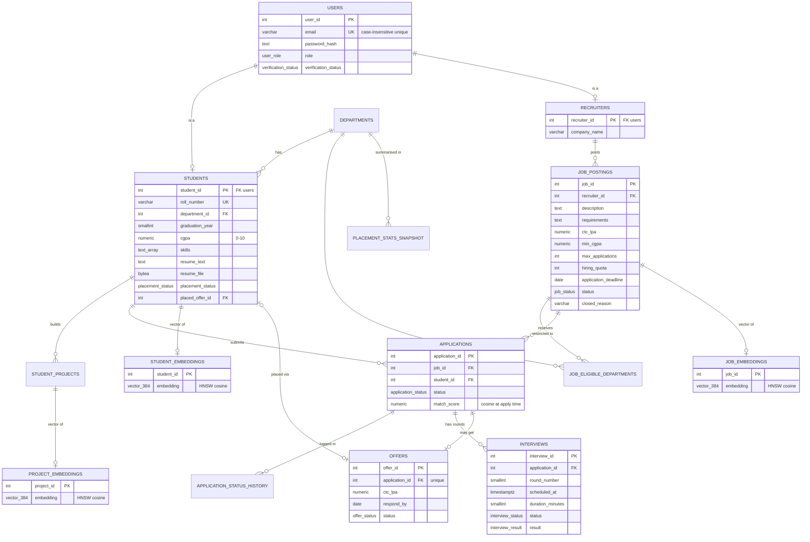

# Database design

PostgreSQL 16 plays both roles in the design. It is the **relational database** (transactional integrity) and, through the **pgvector** extension, the **vector database** (semantic search). Everything below is created by `npm run db:setup` from the files in `db/`.

| File | Contents |
|---|---|
| `00_reset.sql` | drops every project object (used for a clean re-install) |
| `01_schema.sql` | ENUM types, 13 tables, constraints, B-tree / GIN / HNSW indexes |
| `02_triggers.sql` | 7 trigger functions and 9 triggers |
| `03_procedures.sql` | 2 stored procedures and 4 stored functions |
| `04_views.sql` | 2 views |
| `05_reference_data.sql` | department lookup rows |

---

## 1. ER diagram



### Normalisation
* `users` is the supertype. `students` and `recruiters` are 1:1 subtypes that share the primary key (ISA). Role-specific attributes never sit in nullable columns of one wide table.
* Department names live once in `departments`. The many-to-many "job eligible for department" relationship is the junction table `job_eligible_departments`, not a comma-separated list.
* `applications` resolves the student ↔ job many-to-many relationship, with `UNIQUE (job_id, student_id)`.
* Interviews (1:N) and offers (1:1) hang off the application, so every fact depends on the whole key and only the key (**3NF**).
* `skills` / `required_skills` are `TEXT[]` with GIN indexes. They are treated as atomic tag sets used for display and overlap; matching itself is done on vectors.
* `placement_stats_snapshot` is a deliberate, documented **derived** table. It is written only by a stored procedure, as a reporting cache.

### Domain integrity
* **ENUM types** for every status: `user_role`, `verification_status`, `job_status`, `application_status`, `interview_status`, `interview_result`, `offer_status`, `placement_status`, `job_type`, `interview_mode`.
* **CHECK constraints**:
  * CGPA in 0–10, and positive CTC / quota / limits.
  * The e-mail format.
  * A completed interview must carry a result.
  * A placed student must have `placed_at`.
  * A resume is at most 5 MB.
  * An answered offer must have `responded_at`.
  * `closed_reason` comes from a fixed list.
* **Unique constraints**:
  * `lower(email)`
  * `roll_number`
  * `(job_id, student_id)`
  * `(application_id, round_number)`
  * one offer per application

---

## 2. Vector store (pgvector)

| Table | What is embedded | Used for |
|---|---|---|
| `student_embeddings` | headline + skills (weight 2), each project (1.5), resume chunks (1) | matching students ↔ jobs |
| `project_embeddings` | one project | "best-matching project" explanation |
| `job_embeddings` | title + required skills (2), requirements (1.5), description (1) | matching jobs ↔ students |

* **Model:** `all-MiniLM-L6-v2` (384 dimensions) runs inside Node via transformers.js. OpenAI `text-embedding-3-small` with `dimensions=384` is an alternative.
* **Long text:** split into ~160-word overlapping chunks. Each chunk is embedded; the chunk vectors are combined by **weighted mean** and L2-normalised (`lib/embeddings.js`).
* **Metric:** cosine. pgvector's `<=>` operator returns cosine *distance*, so `similarity = 1 - (a <=> b)`.
* **Index:** `USING hnsw (embedding vector_cosine_ops)` on all three tables. It serves `ORDER BY embedding <=> $q LIMIT k` queries as approximate nearest-neighbour search.

The four vector queries in `lib/services/matching.js`:

```sql
-- (a) jobs for a student (or for a free-text query vector)
SELECT j.*, 1 - (je.embedding <=> t.embedding) AS match_score
  FROM job_postings j JOIN job_embeddings je USING (job_id), target t
 WHERE j.status = 'OPEN'
 ORDER BY je.embedding <=> t.embedding;

-- (b) applicants of a job ranked by similarity + best project (LATERAL top-1)
... LEFT JOIN LATERAL (
      SELECT p.title, 1 - (pe.embedding <=> je.embedding) AS similarity
        FROM student_projects p JOIN project_embeddings pe USING (project_id)
       WHERE p.student_id = s.student_id
       ORDER BY pe.embedding <=> je.embedding LIMIT 1) bp ON true
ORDER BY match_score DESC;

-- (c) k-NN "suggested candidates" who have not applied (eligible + unplaced)
SELECT ..., 1 - (se.embedding <=> t.embedding) AS match_score
  FROM student_embeddings se ...
 ORDER BY se.embedding <=> t.embedding LIMIT 15;

-- (d) recruiter free-text talent search
ORDER BY se.embedding <=> $1::vector LIMIT 25;
```

---

## 3. Triggers (`02_triggers.sql`)

| Trigger | Fires | Rule |
|---|---|---|
| `trg_applications_validate_insert` → `fn_validate_application` | BEFORE INSERT on applications | The student must be verified and not placed. The job must be OPEN and before its deadline. The student must meet `min_cgpa` and the department restriction. It locks the student row `FOR SHARE` and then the job row `FOR UPDATE`, so concurrent applications serialise. |
| `trg_applications_status_transition` → `fn_enforce_application_transition` | BEFORE UPDATE OF status | State machine: APPLIED → SHORTLISTED → INTERVIEWING → OFFERED → ACCEPTED. REJECTED and WITHDRAWN can be reached from any live state. Final states cannot change. |
| `trg_applications_log_status` → `fn_log_application_status` | AFTER INSERT / UPDATE OF status | Writes a milestone row into `application_status_history`, with the acting user (`app.user_id`) and a note (`app.status_note`). |
| **`trg_applications_auto_close_job` → `fn_auto_close_job`** | AFTER INSERT / UPDATE OF status | **When active applications reach `max_applications`, sets the job to CLOSED (`APPLICATION_LIMIT_REACHED`). When ACCEPTED applications reach `hiring_quota`, sets it to CLOSED (`HIRING_QUOTA_FILLED`), auto-rejects the remaining in-progress applications and cancels their interviews.** |
| `trg_interviews_validate` → `fn_validate_interview` | BEFORE INSERT / UPDATE | Interviews must be in the future and attached to a live application. No two SCHEDULED interviews of the same student may overlap; a `pg_advisory_xact_lock` per student makes this check race-free. |
| `trg_offers_validate_insert` → `fn_validate_offer` | BEFORE INSERT on offers | Offers go only to unplaced students with a live application, and the response date cannot be in the past. |
| `trg_students_lock_placement` → `fn_lock_placed_student` | BEFORE UPDATE OF placement_status | Once a student is PLACED, only a session with `app.user_role = ADMIN` can change it. |
| `trg_*_updated_at` → `fn_set_updated_at` | BEFORE UPDATE | Maintains `updated_at`. |

Trigger errors use `RAISE EXCEPTION` (SQLSTATE `P0001`). The app shows the message directly to the user (`lib/errors.js`), so the rule and its explanation live in one place.

---

## 4. Stored procedures & functions (`03_procedures.sql`)

| Object | Kind | Purpose |
|---|---|---|
| `sp_refresh_placement_stats(p_graduation_year)` | **PROCEDURE** (`CALL`) | Recomputes department-wise totals, placed count, **placement %, average / median / highest / lowest CTC** and offers. Writes them into `placement_stats_snapshot` (year 0 = all batches). |
| `fn_department_placement_stats(year)` | FUNCTION, returns a table | The live computation used by the procedure (`percentile_cont` for the median). |
| `fn_overall_placement_summary(year)` | FUNCTION | Institute-wide KPIs for the admin dashboard. |
| `fn_company_hiring_stats(year)` | FUNCTION | Jobs, applications, offers, hires and average CTC per company. |
| `fn_job_funnel(job_id)` | FUNCTION | Count per application status (zero-filled with `enum_range`). |
| `sp_run_maintenance()` | **PROCEDURE** | Closes OPEN jobs past their deadline and expires PENDING offers past `respond_by`, withdrawing the related applications. |

```sql
CALL sp_refresh_placement_stats(2027);
SELECT * FROM placement_stats_snapshot WHERE graduation_year = 2027;
SELECT * FROM fn_overall_placement_summary(NULL);
```

---

## 5. The offer-acceptance transaction

`lib/services/offers.js → acceptOffer()` runs inside `withTransaction()` (`BEGIN … COMMIT`, `ROLLBACK` on any error):

```sql
BEGIN;
SELECT set_config('app.user_id', '42', true);              -- audit context for triggers
SELECT placement_status FROM students
 WHERE student_id = 42 FOR UPDATE;                          -- 1. lock the student
SELECT ... FROM offers o JOIN applications a USING (application_id)
 WHERE o.offer_id = 7 FOR UPDATE OF o, a;                  -- 2. lock + validate the offer
UPDATE offers       SET status = 'ACCEPTED' ...;            -- 3
UPDATE applications SET status = 'ACCEPTED' ...;            -- 4  (quota trigger may close the job)
UPDATE offers       SET status = 'DECLINED' ... other pending offers;        -- 5
UPDATE interviews   SET status = 'CANCELLED' ... still scheduled;            -- 6
UPDATE applications SET status = 'REJECTED' ... other live applications;     -- 7
UPDATE students     SET placement_status = 'PLACED', placed_offer_id = 7;    -- 8 (now locked by trigger)
COMMIT;
```

* **Atomicity:** if any step fails (for example, a trigger raises), everything rolls back. The student is never half-placed.
* **Isolation:**
  * Two acceptances by the same student cannot both succeed. The second waits on the `FOR UPDATE` row lock, then sees `PLACED` and aborts.
  * An `applyToJob()` racing with the acceptance waits on the same row (the trigger takes `FOR SHARE`), then sees `PLACED` and is refused.
* **Deadlock avoidance:** every code path locks in the same order, **student → application/offer → job**.
  * `issueOffer()` deliberately takes the student lock (`FOR SHARE`) *before* the application lock.
  * The application trigger locks the student before the job.

Other multi-statement transactions:
* registration (`users` + `students`/`recruiters`)
* job creation (posting + eligible departments)
* `applyToJob` (similarity + insert + triggers)
* `issueOffer`
* `scheduleInterview` (next round number + insert + status change)
* `withdrawApplication`
* `declineOffer`
* recruiter shortlist / reject (rejecting also revokes a pending offer)

---

## 6. Views
* `v_application_overview`: one row per application, with job, company, student, department and offer.
* `v_student_directory`: student profile flags (has resume, has embedding) without loading resume bytes.
